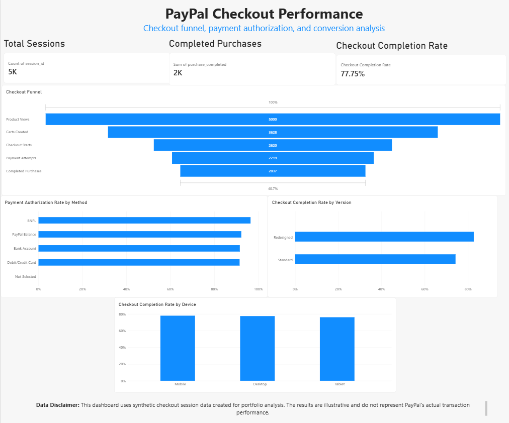

# PayPal Checkout Performance Analysis

## Project Overview
A Business Analyst portfolio project exploring checkout funnel performance, payment authorization, and checkout completion using SQL, SQLite, Python, and Power BI.

The business context is informed by publicly available information about PayPal's branded checkout strategy. The dashboard analysis uses a separately generated synthetic dataset.

## Business Questions
- Where do users drop off in the checkout funnel?
- How does checkout completion vary by device?
- How does the redesigned checkout experience compare with the standard experience?
- How do payment authorization rates vary by payment method?
- What opportunities could improve the checkout experience?

## Tools & Technologies
- SQL / SQLite
- Python
- Microsoft Power BI
- CSV data analysis
- Business requirements and KPI analysis

## Dashboard
The Power BI dashboard explores:
- Checkout funnel performance
- Overall checkout completion rate
- Payment authorization rate by method
- Completion rate by checkout version
- Completion rate by device

[Download the Power BI report](PayPal_Checkout_Analysis.pbix)

## Repository Contents
- `synthetic_checkout_sessions.csv` — synthetic checkout session dataset
- `checkout_analysis_queries.sql` — primary SQL analysis queries
- `practice_queries.sql` — supplementary SQL queries
- `data_dictionary.csv` — definitions of dataset fields

## Data Disclaimer
**The dataset is synthetic and does not contain PayPal's actual transaction data. Dashboard metrics and findings are illustrative, not actual PayPal performance, and do not establish causation.** Public information is used only to frame the business problem.

## Project Status
- [x] Business problem and public evidence review
- [x] Checkout and competitor analysis
- [x] Synthetic dataset and SQL analysis
- [x] Power BI dashboard
- [x] Final recommendations and documentation
